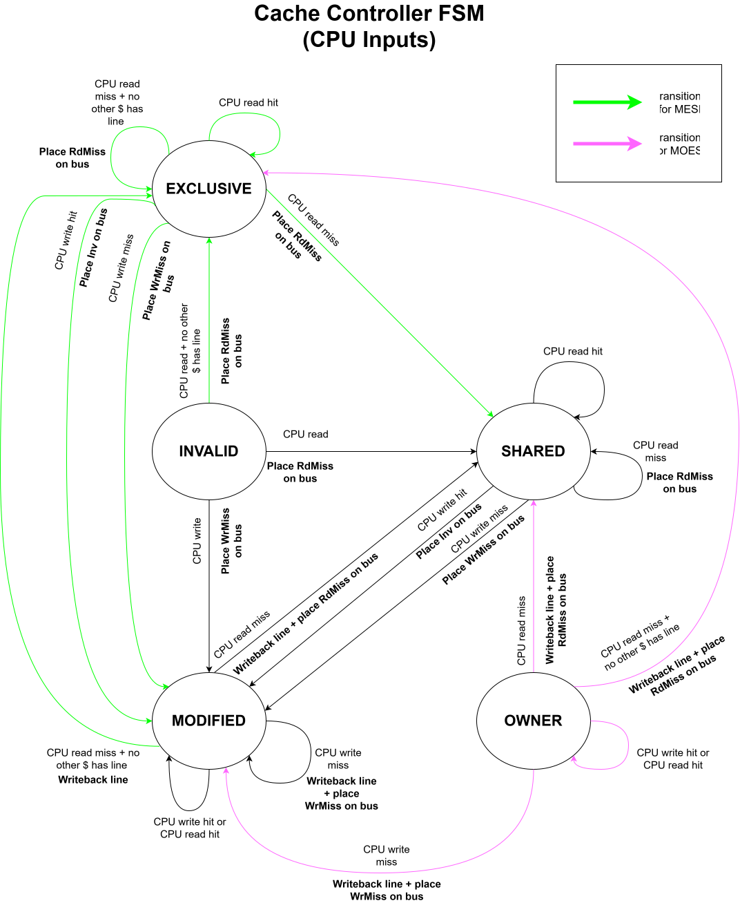
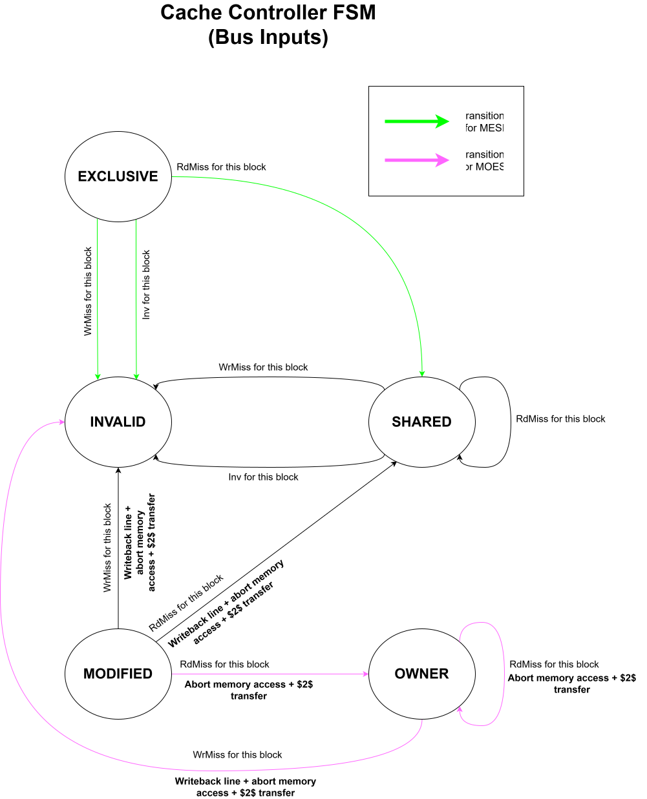

# Cache Controller

## FSM Diagrams

Note: FSM diagrams are shown separately for clarity but are implemented as one FSM in hardware

### Core Inputs FSM

- `local_inst` is the core's request
- `RdMiss` sent over the `mem_req` port, where:
    - `mem_req.req = 1`
    - `mem_req.addr = local_inst.addr`
    - `mem_req.data = local_inst.data`
    - `mem_req.wen = local_inst.op` 
    - If line needs to be written back:
        - `mem_req.wb = 1`
- `WrMiss` sent over the `mem_req` port, where:
    - `mem_req.req = 1`
    - `mem_req.addr = local_inst.addr`
    - `mem_req.data = local_inst.data`
    - `mem_req.wen = local_inst.op` 
    - If line needs to be written back:
        - `mem_req.wb = 1`
- `Inv` sent over the `inv` port, where:
    - `inv.inv = 1`
    - `inv.addr = local_inst.addr`
- `Transfer` sent over the `transfer` port, where:
    - `transfer.transfer = 1`
    - `transfer.addr = local_inst.addr`
    - `transfer.data = local_inst.data`

### Bus Inputs FSM

- `snoop_inst` is the bus request

### Conditional State Transitions

- If `protocol != 0`:
    - `INVALID` to `EXCLUSIVE` and `MODIFIED` to `EXCLUSIVE` state transitions are enabled
- If `protocol[1]`:
    - `MODIFIED` to `OWNER` state transition is enabled

### States

- `INVALID`
- `SHARED`
- `MODIFIED`
- `EXCLUSIVE`
- `OWNER`

## Structures

- `logic [2:0] current_state, next_state`
- `line_t cache [D_CACHE_SIZE]`: Data cache registers
- `logic [$clog2(DCACHE_SIZE)-1:0] line_idx`: Current address's index in the cache
- `logic [TAG_WIDTH-1:0] tag`: Cache tag (only for cache writes to update tag)
- `logic [IDX_WIDTH-1:0] idx`: Cache index
- `logic [ADDR_WIDTH-1:0] din`: Data for cache writes
- `logic [ADDR_WIDTH-1:0] wen`: Cache write enable signal

## Control Flow

- If `read_all`:
    - `line_idx` = 0
    - For `curr_idx in [0, DCACHE_SIZE-1]`:
        - `line_out` = `cache[curr_idx]`

