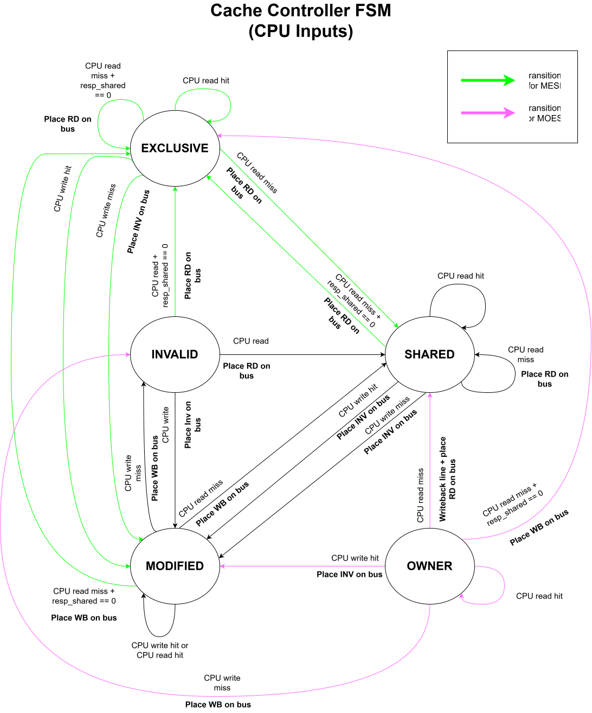
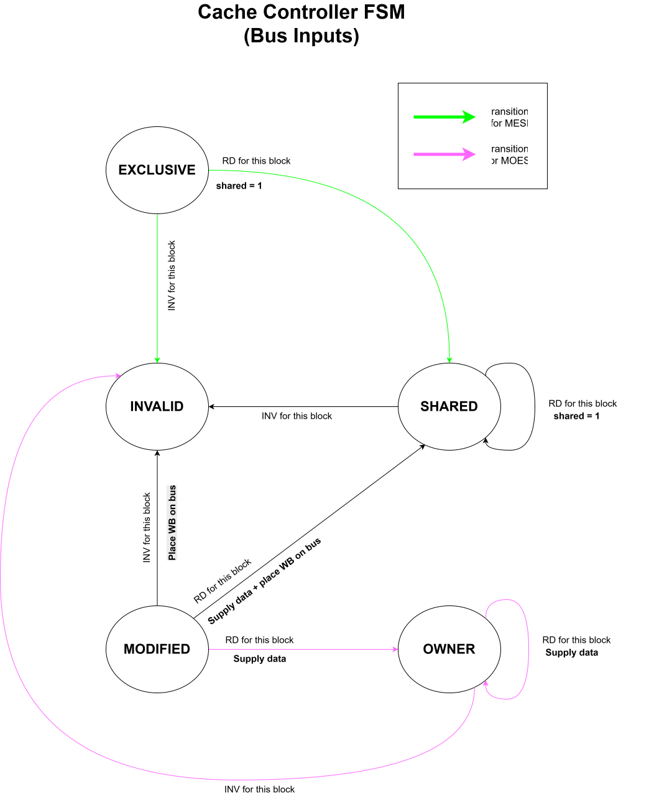

# Cache Controller

Holds the data cache and implements the coherence protocol. Its only registers are the cache lines. The bus request it presents is recomputed every cycle from the current instruction and the current line, so no request FSM is needed, and a request that is overtaken by a snoop (for example an upgrade whose line gets invalidated first) corrects itself on the next cycle.

## Storage

- `line_t cache [DCACHE_SIZE]` (2 x 5 = 10 flops). Nothing else.

## Address decode (combinational)

For the local address `A = local_inst.addr`:

- `idx = A[IDX_WIDTH-1:0]`, `tag = A[ADDR_WIDTH-1:IDX_WIDTH]`, `line = cache[idx]`
- `hit = line.v && line.tag == tag`
- `evict = line.v && line.d && !hit` (the slot holds a different, dirty line)

For the snooped address `snoop_addr`: `s_idx`, `s_tag`, `s_line = cache[s_idx]` likewise, and

- `snoop_hit = s_line.v && s_line.tag == s_tag`
- `snoop_owner = snoop_hit && s_line.d`
- `snoop_data = s_line.data`

These three outputs are always driven; the bus samples them during a whole transaction.

## Priority

Each cycle exactly one of these happens, in this order:

1. `snoop_valid`: apply table 2. The local instruction is held and not examined this cycle.
2. `local_valid`: apply table 1.
3. Otherwise nothing.

A core is never snooped during its own transaction, so a request in flight cannot be disturbed.

## Table 1: local instruction

Evaluated when `local_valid && !snoop_valid`. "At done" is the cycle in which the bus asserts `done` for this core; the line is written at the end of that cycle and `inst_done` is asserted during it. `req`, `req_type`, `addr` and `data` stay stable until then because nothing can change the line in between (see [bus.md](./bus.md)).

| # | Condition | Bus request (`req_type`, `addr`, `data`) | Line update | `inst_done` |
|---|---|---|---|---|
| 1 | read, `hit` | none | none | this cycle |
| 2 | write, `hit`, `line.x` (E or M) | none | `d <= 1` (E→M) | this cycle |
| 3 | write, `hit`, `!line.x` (S or O) | `INV, A, -` | at done: `data <= inst.data; d <= 1; x <= 1` (→M) | at done |
| 4 | `!hit && evict` | `WB, {line.tag, idx}, line.data` | at done: `v, d, x <= 0` (→I); the instruction is retried next cycle and lands in row 5 or 6 | no |
| 5 | read, `!hit && !evict` | `RD, A, -` | at done: `tag <= tag; data <= resp_data; v <= 1; d <= 0; x <= e_en && !resp_shared` (→E or S) | at done |
| 6 | write, `!hit && !evict` | `INV, A, -` | at done: `tag <= tag; data <= inst.data; v <= 1; d <= 1; x <= 1` (→M) | at done |

Rows 3 and 6 have the same update, so an `INV` completing always leaves `{tag, inst.data, M}`. Row 6 is write-validate: a write miss never fetches the line, it only invalidates the other copies. Clean victims (S or E) are overwritten silently; only dirty victims (M or O) go through row 4.

## Table 2: snooped transaction

Evaluated when `snoop_valid`. Only a line with `snoop_hit` changes.

| `snoop_type` | from S | from E | from M | from O | Update |
|---|---|---|---|---|---|
| `RD` | S | S | O if `o_en`, else S | O | `x <= 0; d <= d && o_en` |
| `INV` | I | I | I | I | `v, d, x <= 0` |
| `WB` | S | E | M | O | none |

When an M line drops to S (O disabled), the bus writes this cache's `snoop_data` to memory in the same cycle, so the dirty value is not lost. When it becomes O, memory stays stale and this cache supplies the data to every later `RD` until it evicts the line with a `WB`.

## Timing

- Rows 1 and 2 take one cycle and never use the bus.
- A bus request completes in the cycle `done` arrives: in the grant cycle for `INV` and for `RD` served by an owner (O enabled), or `MEM_LATENCY` cycles later for `WB` and `RD` served by memory.
- Snoopers update at the end of the grant cycle; the requester updates at the end of the done cycle.
- A snooped core loses the grant cycle for local work. That is the same for every protocol and is the real cost of bus traffic on other cores.

## Diagrams

