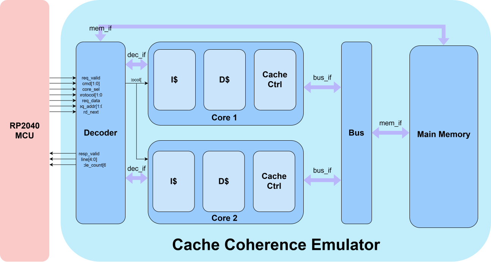

# Cache Coherence Emulator Project Proposal

## Statement of Purpose

The Cache Coherence Emulator implements one of the MSI, MESI or MOESI cache coherence protocols and models its behaviour by emulating read and write memory transactions over a shared bus. The coherence protocol is configured by the I/O pins, allowing each protocol's performance to be compared.

## System Diagram

Module interfaces and ports are in [uarch.md](./uarch.md); the reasoning behind each design choice is in [decisions.md](./decisions.md).

## Pinout

Pin meaning depends on the phase of a run (LOAD, RUN, READ). Positions below are for the default configuration; the general bit formats are in [encodings.md](./encodings.md).

### LOAD: the MCU sends one command per clock

- `req_valid = ui_in[0]`: Execute the command on the pins
- `cmd[1:0] = ui_in[2:1]`: 00 load read instruction, 01 load write instruction, 10 load memory word, 11 start the run
- `core_sel = ui_in[3]`: Core receiving the instruction
- `req_addr[1:0] = ui_in[5:4]`: Instruction address, or memory address
- `req_data = ui_in[6]`: Instruction data bit, or memory word
- `ui_in[7]`, `uio_in[7:0]`: unused in this configuration. All `uio` pins are inputs (`uio_oe = 0`), so larger configurations have 16 input bits

### RUN

- `protocol_sel[1:0] = ui_in[4:3]`: 00 MSI, 01 MESI, 10 MOESI (11 is reserved and behaves as MOESI). Driven together with the start command and held until `resp_valid = 1`
- `cycle_count[6:0] = uo_out[7:1]`: counts up during the run
- All other inputs are ignored. The MCU must release its `uio` drivers after the start command

### READ: the ASIC returns one cache line per `rd_next`

- `resp_valid = uo_out[0]`: The run has finished; `cycle_count` is final and a line is on `uio_out`
- `cycle_count[6:0] = uo_out[7:1]`: Program cycle count, saturating at 127
- `line[4:0] = uio_out[4:0]`: Cache line `{tag, data, valid, dirty, exclusive}` (see [encodings.md](./encodings.md)). All `uio` pins are outputs (`uio_oe = 8'hFF`); `uio_out[7:5] = 0`
- `rd_next = ui_in[0]`: Advance to the next line on the clock

## Specifications

- 2 cores, each with a 4-instruction instruction cache and a 2-line private data cache
    - A memory instruction is `{address[1:0], data, read/write}`, 4 bits
    - A cache line is `{tag, data, valid, dirty, exclusive}`, 5 bits; direct mapped, one word per line
- Main memory has 4 words of 1 bit
- Write policy: write-back, write-allocate, no fetch on write (write-validate). A write miss only invalidates other copies
- Bus transactions: `RD` (fetch), `INV` (invalidate others), `WB` (write back). Snooping caches see every transaction
- Bus uses round-robin arbitration. A transaction that touches main memory occupies the bus for `1 + MEM_LATENCY` cycles (default 3); one served without memory takes 1 cycle
- Only MODIFIED/OWNER lines supply data to other caches; otherwise memory does
- Storage: 77 flip-flops (see [uarch.md](./uarch.md))

## Timeline

### Design

Deadline: October 22nd

- Create a block diagram and documentation for the microarchitecture outlining how the design is partitioned into RTL modules and how data is passed around the chip (Will and Greg)
    - Cache coherence protocol FSMs will have their own diagrams and timing specifications (Will and Greg)
- Design the logic to initialize main memory and instruction caches based on control and data signals from the RP2040 MCU (Greg)

### RTL Implementation

Deadline: November 5th

- Implement the microarchitecture from the documentation in SystemVerilog
- The main functional blocks of the chip are:
    - Decoder (Will)
    - Bus (Will)
        - Round-robin arbitration scheme and the memory latency model
    - M(O)(E)SI protocol (Will and Greg)
        - Implemented as the MOESI transitions with the E and O states gated by the configured protocol
    - Cache Controller (Will and Greg)
        - Recomputes its bus request every cycle from the instruction and the cache line; commits when the bus signals `done`

### Verification

Deadline: November 19th

- Each block will be verified using a combination of directed tests and constrained random verification
- The chip as a whole will also be verified using test programs and checking the cache states after the programs have finished
- Verification will be also be evaluated using functional and code coverage to estimate the extent to which our tests cover the design (ideally 95%+ for both)
- Responsibilities for verification are the same for implementation
